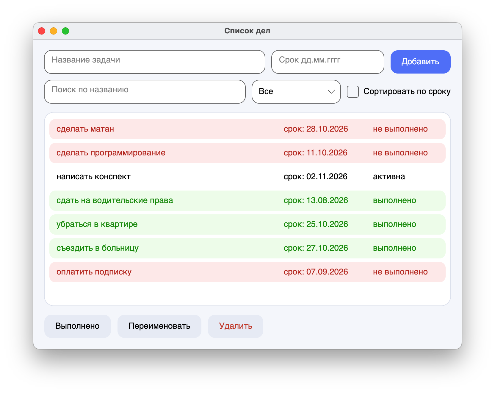

# Лаба 1. Список дел

**Автор:** Лихач Алевтина, Б9125-01.03.02ии(4)

## Как запустить

Нужен .NET SDK библиотека окна Avalonia, работает на macOS.

```
cd lab1-todo
dotnet run
```

Задачи сохраняются в файл `todos.json` рядом с собранной программой (папка `bin/`).

## Скриншот



## Чек-лист

- [x] 1. Модель: `TodoItem` и `TodoList`, поля закрыты, изменение через методы, в модели нет окна и вывода
- [x] 2. Окно: поле ввода, кнопка «Добавить», список задач с признаком выполнения и сроком
- [x] 3. Операции: выполнить, переименовать, удалить, список обновляется сразу
- [x] 4. Ошибки: пустое название, действие без выбранной задачи, неверный срок: сообщение, программа работает дальше
- [x] 5. Сохранение: JSON (`System.Text.Json`), нет файла: пустой список
- [x] 6. README
- [x] ★ Фильтр «все / активные / выполненные» и сортировка по сроку (методом `TodoList.GetView`)
- [x] ★★ Поиск по мере ввода (`TodoList.GetView`), просроченные задачи выделены цветом

## Как устроен проект

| Файл | Класс | Что делает |
|------|-------|------------|
| `TodoItem.cs` | `TodoItem` | Одна задача: название, признак выполнения, срок. Пустое название запрещено |
| `TodoList.cs` | `TodoList`, `TodoFilter` | Список задач: добавить, удалить, выполнить, переименовать, фильтр, сортировка, поиск, сохранение и загрузка JSON |
| `MainWindow.axaml` | | Разметка окна (поля, кнопки, список) |
| `MainWindow.axaml.cs` | `MainWindow` | Окно: показывает модель, обрабатывает нажатия, ловит исключения и показывает сообщения |
| `Program.cs`, `App.axaml`, `App.axaml.cs` | `Program`, `App` | Запуск приложения (создаются шаблоном Avalonia) |

Наследования в проекте нет, `MainWindow` наследуется от `Window`, `App` от `Application` (библиотека Avalonia).
Использовано: Avalonia, `System.Text.Json`, LINQ.

Как пользоваться: чтобы переименовать задачу, выберите её в списке (название появится
в поле ввода), измените текст и нажмите «Переименовать». Срок вводится как `дд.мм.гггг`
и необязателен.
