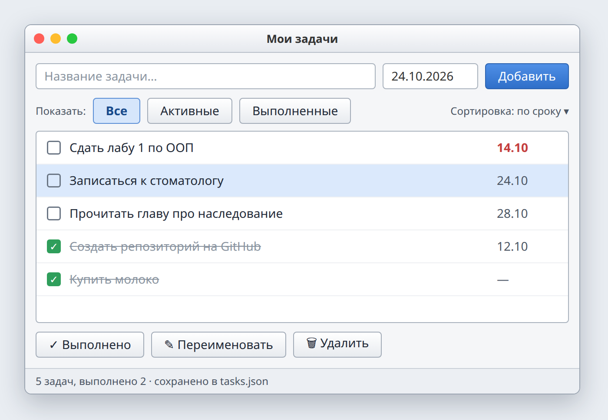

# Лаба 1. Список дел

| | |
| --- | --- |
| Состав | 1 человек |
| Выдача | 17.10.2026 |
| Срок PR | 30.10.2026, 23:59 |
| Сдача | 31.10.2026 |
| Ветка, папка | `lab1`, `lab1-todo/` |
| Баллы | 14: чек-лист 6, вопрос 2, ★ 3, ★★ 3 |



*Примерный вид. Оформление на ваш выбор.*

## Темы

Класс и объект, поля и методы, конструктор, `this`, инкапсуляция, исключения, модель и окно, обработчики событий, сохранение объектов в файл.

## Теория

**Класс и объект.** Класс описывает данные (поля) и действия (методы). Объект это конкретный экземпляр класса со своими значениями. Класс `TodoItem` один, задач-объектов сколько угодно.

**Конструктор** вызывается при создании объекта и задаёт начальные значения полей. После конструктора объект уже корректен.

```csharp
public class TodoItem
{
    private string _title = "";
    private bool _done;

    public TodoItem(string title)
    {
        Rename(title);
        _done = false;
    }

    public string Title => _title;
    public bool IsDone => _done;

    public void Complete() => _done = true;

    public void Rename(string title)
    {
        if (string.IsNullOrWhiteSpace(title))
            throw new ArgumentException("Название не может быть пустым");
        _title = title.Trim();
    }
}
```

**`this`.** Метод один на весь класс, а объектов много. `this` это объект, у которого вызван метод: при `item2.Complete()` меняется только `item2`.

**Инкапсуляция.** Поля закрыты (`private`), менять их можно только через методы. Метод проверяет данные и не даёт объекту попасть в неправильное состояние: пустое название не пройдёт.

**Исключения.** Модель не знает, где её показывают, поэтому об ошибке сообщает исключением. Окно ловит его (`try` / `catch`) и показывает сообщение.

**Модель и окно.** Модель (`TodoItem`, `TodoList`) хранит данные и правила и ничего не знает об окне. Окно показывает модель и передаёт ей действия пользователя. Список на экране каждый раз перерисовывается по модели.

**События.** Окно реагирует на события: нажатие кнопки, выбор строки. Обработчик берёт ввод, вызывает метод модели и обновляет окно.

```csharp
private void AddButton_Click(object sender, EventArgs e)
{
    try
    {
        _list.Add(titleBox.Text);
        RefreshList();
    }
    catch (ArgumentException ex)
    {
        MessageBox.Show(ex.Message);
    }
}
```

**Сохранение.** Объекты превращаются в JSON и записываются в файл, при запуске читаются обратно (`System.Text.Json`, Gson, kotlinx.serialization, nlohmann/json).

## Задание

Оконное приложение для списка задач. Пользователь может:

1. ввести название и добавить задачу;
2. отметить задачу выполненной;
3. переименовать задачу;
4. удалить задачу;
5. закрыть программу и открыть снова: задачи на месте.

У задачи есть название, признак выполнения и одно поле на выбор: срок, приоритет или категория.

| Класс | Отвечает за |
| --- | --- |
| `TodoItem` | одна задача |
| `TodoList` | список задач: добавить, удалить, найти, сохранить, загрузить |
| `MainForm` | окно |

`TodoItem` и `TodoList` не используют библиотеку окна и ничего не выводят сами.

## Чек-лист

1. **Модель.** Классы задачи и списка задач, поля закрыты, изменение только через методы. В модели нет окна и вывода.
2. **Окно.** Поле ввода, кнопка «Добавить», список задач с отметкой выполнения и дополнительным полем.
3. **Операции.** Выполнить, переименовать, удалить. Список обновляется сразу.
4. **Ошибки.** Пустое название, действие без выбранной задачи, неверное значение доп. поля: сообщение, программа работает дальше. Пустое название запрещено в модели.
5. **Сохранение.** Задачи сохраняются в JSON и загружаются при запуске. Нет файла: пустой список.
6. **README.** Как запустить, скриншот, чек-лист, как устроен проект.

## Доп. задания

**★ (3 балла).** Фильтр «все / активные / выполненные» и сортировка по доп. полю. Сделаны методами `TodoList`.

**★★ (3 балла).** Поиск: поле поиска, список фильтруется по мере ввода (метод `TodoList`). Задачи с истёкшим сроком (или высоким приоритетом) выделены цветом.

## Вопросы

1. Чем класс отличается от объекта?
2. Что делает конструктор?
3. Зачем поля делают закрытыми?
4. Что такое `this`?
5. Почему модель сообщает об ошибке исключением, а не показывает окно?
6. Что такое обработчик события?
7. Задачи хранятся в окне или в модели?
8. Как задачи попадают в файл и обратно?
