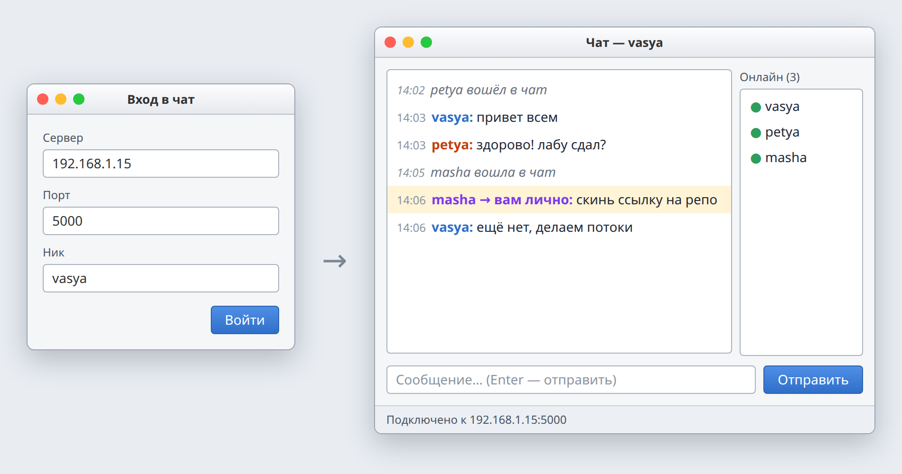

# Лаба 3. Онлайн-чат

| | |
| --- | --- |
| Состав | 2 человека |
| Выдача | 14.11.2026 |
| Срок PR | 27.11.2026, 23:59 |
| Сдача | 28.11.2026 |
| Папка | `lab3-chat/` в репозитории пары |
| Баллы | 14 каждому: чек-лист 6, вопрос 2, ★ 3, ★★ 3 |



*Примерный вид клиента. Сервер может быть консольным.*

## Темы

Клиент и сервер, IP-адрес и порт, TCP-сокет, протокол и JSON, потоки, блокировка общих данных, обновление окна из другого потока, единственная ответственность класса.

## Теория

**Клиент и сервер.** Сервер запускается первым и ждёт подключений на порту. Клиент подключается по IP-адресу компьютера с сервером и номеру порта. Чтобы подключались с других компьютеров, сервер слушает все адреса (`IPAddress.Any`).

**Сокет и TCP.** Через сокет программа отправляет и получает байты. TCP доставляет байты по порядку, но не сохраняет границы сообщений: два сообщения могут прийти склеенными, одно частями. Поэтому одно сообщение = одна строка, читаем построчно.

**Протокол.** Клиент и сервер договариваются о формате сообщений. Сообщение описывается классом и передаётся строкой JSON:

```json
{"type": "text", "nick": "vasya", "text": "привет", "time": "14:03"}
```

```csharp
public record ChatMessage(string Type, string Nick, string Text, DateTime Time)
{
    public string ToJson() => JsonSerializer.Serialize(this);
    public static ChatMessage FromJson(string line) => JsonSerializer.Deserialize<ChatMessage>(line)!;
}
```

**Потоки.** Чтение из сокета ждёт, пока придут данные. Если ждать в потоке окна, окно замирает. Поэтому сервер обслуживает каждого клиента в своём потоке (или `async`), а клиент читает сеть в отдельном потоке.

```csharp
var listener = new TcpListener(IPAddress.Any, 5000);
listener.Start();
while (true)
{
    TcpClient client = listener.AcceptTcpClient();
    var handler = new ClientHandler(this, client);
    new Thread(handler.Run) { IsBackground = true }.Start();
}
```

**Блокировка.** Список подключённых клиентов меняют несколько потоков сразу. Доступ к нему защищается блокировкой (`lock`), иначе список может испортиться.

**Поток окна.** Элементы окна можно менять только из потока окна. Поток сети передаёт сообщение в окно через `Invoke` (WinForms), `Dispatcher` (WPF, Avalonia), `Platform.runLater` (JavaFX).

**Единственная ответственность.** У каждого класса одна задача: сообщение, сервер, обработчик одного клиента, сетевой клиент, окно. Сетевой клиент не знает про окно: входящие сообщения отдаёт через событие.

```csharp
public class ChatClient
{
    public event Action<ChatMessage>? MessageReceived;
    // ... поток чтения вызывает MessageReceived?.Invoke(message)
}
```

## Задание

Сервер и оконный клиент группового чата. Пользователь может:

1. ввести адрес сервера, порт и ник и войти;
2. получить отказ, если ник занят;
3. видеть ленту с ником, временем и текстом, уведомления о входе и выходе;
4. видеть список участников онлайн;
5. отправить сообщение кнопкой или Enter, его получают все;
6. получить сообщение об ошибке, если сервер недоступен.

| Класс | Отвечает за |
| --- | --- |
| `ChatMessage` | одно сообщение, преобразование в JSON и обратно |
| `ChatServer` | приём подключений, список клиентов, рассылка |
| `ClientHandler` | одно подключение на сервере |
| `ChatClient` | подключение, отправка, чтение в фоне |
| `LoginForm`, `ChatForm` | окна |

Готовые чат-сервисы (Firebase, Telegram API) использовать нельзя.

## Чек-лист

1. **Сервер и клиент.** Отдельные программы. Адрес и порт вводятся в окне входа. Работает на разных компьютерах.
2. **Вход.** Вход с ником, отказ при занятом нике, уведомления о входе и выходе.
3. **Чат.** Лента с ником и временем, отправка кнопкой и Enter, сообщение получают все. Список онлайн актуален.
4. **Классы и протокол.** Классы из таблицы (или аналогичные). Сетевой клиент не зависит от окна. Протокол описан в README.
5. **Устойчивость.** Окно не замирает. Отключение клиента не ломает сервер и остальных. Недоступный сервер: сообщение, а не вылет.
6. **README.** Как запустить, скриншот, чек-лист, как устроен проект, протокол, кто что делал.

## Доп. задания

**★ (3 балла).** Личные сообщения: выбрать адресата в списке онлайн, сообщение видят только двое, в ленте оно выделено.

**★★ (3 балла).** История: сервер сохраняет сообщения в файл и отправляет новому клиенту последние 20, в том числе после перезапуска сервера.

## Вопросы

1. Чем сервер отличается от клиента?
2. Что такое порт?
3. Почему сообщения нужно разделять?
4. Зачем серверу поток на каждого клиента?
5. Почему окно замирает, если читать сеть в его потоке?
6. Зачем нужна блокировка общего списка клиентов?
7. Почему сетевой клиент не должен знать про окно?
8. Какую часть писал ты?
