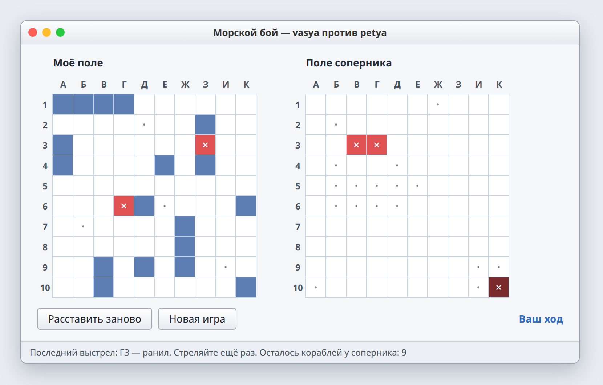

# Лаба 4. Морской бой по сети

| | |
| --- | --- |
| Состав | 2 человека (та же пара) |
| Выдача | 28.11.2026 |
| Срок PR | 18.12.2026, 23:59 |
| Сдача | 19.12.2026 |
| Папка | `lab4-battleship/` в репозитории пары |
| Баллы | 14 каждому: чек-лист 6, вопрос 2, ★ 3, ★★ 3 |



*Примерный вид. Оформление на ваш выбор.*

## Темы

Модель, окно и сеть, перечисления (enum), состояние объекта, композиция, собственные исключения. Сетевую часть можно взять из лабы 3.

## Теория

**Модель, окно, сеть.** Правила игры (можно ли поставить корабль, попал ли выстрел, чей ход, кто победил) находятся только в модели. Окно показывает модель и передаёт ей щелчки, сеть пересылает ходы. Модель не знает ни про окно, ни про сокеты.

**Перечисление.** Тип с фиксированным набором значений. Состояние клетки и результат выстрела хранятся перечислением, а не строками или числами: опечатка сразу становится ошибкой компиляции.

```csharp
public enum Cell { Empty, Ship, Miss, Hit }
public enum ShotResult { Miss, Hit, Sunk }
public enum GameState { Placing, MyTurn, EnemyTurn, Over }
```

**Состояние.** Игра проходит этапы: расстановка, мой ход, ход соперника, конец. Текущее состояние хранится в модели, и модель сама отклоняет недопустимое: выстрел не в свою очередь или после конца игры.

**Композиция.** Игра содержит поля, поле содержит корабли. Корабль знает, потоплен ли он; поле знает, куда попал выстрел; игра знает, чей ход.

**Свои исключения.** Нарушение правил описывается своим классом. Модель бросает его, окно ловит и показывает текст.

```csharp
public class RuleException : Exception
{
    public RuleException(string message) : base(message) { }
}

public ShotResult Shoot(int x, int y)
{
    if (State != GameState.MyTurn)
        throw new RuleException("Сейчас ход соперника");
    // ...
}
```

**Кто считает результат.** Корабли соперника не передаются по сети. Передаются координаты выстрела, а результат («мимо», «ранил», «убил») считает сторона, у которой стоят корабли.

**Правила.** Поле 10×10. Флот: 1 четырёхпалубный, 2 трёхпалубных, 3 двухпалубных, 4 однопалубных. Корабли не касаются друг друга даже углами.

## Задание

Морской бой для двух игроков на разных компьютерах. Пользователь может:

1. создать игру или подключиться по адресу;
2. получить флот, расставленный автоматически по правилам;
3. видеть своё поле и поле соперника;
4. стрелять щелчком в свой ход, после попадания стрелять ещё раз;
5. видеть результат выстрела, клетки вокруг потопленного корабля отмечаются автоматически;
6. видеть, чей ход, и в конце «Победа» или «Поражение».

| Класс | Отвечает за |
| --- | --- |
| `Cell`, `ShotResult`, `GameState` | перечисления |
| `Ship` | клетки корабля, попадания, потоплен ли |
| `Board` | поле 10×10, расстановка, проверка правил, приём выстрела |
| `Game` | два поля, состояние, очередь хода |
| `RuleException` | нарушение правил |
| `Connection` | передача ходов по сети |
| `MainForm` | окно |

## Чек-лист

1. **Сеть.** Игра между двумя компьютерами: один создаёт игру, второй подключается по адресу.
2. **Окно.** Два подписанных поля, выстрел щелчком, строка состояния: чей ход и результат выстрела.
3. **Расстановка.** Автоматическая расстановка классического флота, корабли не касаются даже углами. Проверка в `Board`.
4. **Ход игры.** Очерёдность, повторный ход после попадания, «мимо / ранил / убил», отметка клеток вокруг потопленного, победа и поражение у обоих.
5. **Модель.** Правила только в модели, обработчики окна и сетевой код их вызывают. Состояние клетки и игры хранится перечислениями. Модель не зависит от окна и сети.
6. **Ошибки и README.** Повторный выстрел и ход не в свою очередь отклоняются с сообщением, разрыв соединения не роняет программу. README: как запустить, скриншот, чек-лист, как устроен проект, протокол, кто что делал.

## Доп. задания

**★ (3 балла).** Ручная расстановка мышью с поворотом корабля и подсветкой недопустимой позиции. Новая партия без перезапуска программ.

**★★ (3 балла).** Игра против компьютера. Абстрактный класс игрока и наследники: локальный, сетевой, бот. Игра не проверяет, кто именно играет. Бот после попадания добивает корабль.

## Вопросы

1. Где решается, попал ли выстрел?
2. Что такое enum и зачем он здесь?
3. Где хранится, чей сейчас ход?
4. Как модель не даёт выстрелить не в свою очередь?
5. Что передаётся по сети при выстреле?
6. Зачем свой класс исключения?
7. Можно ли запустить модель без окна?
8. Какую часть писал ты?
