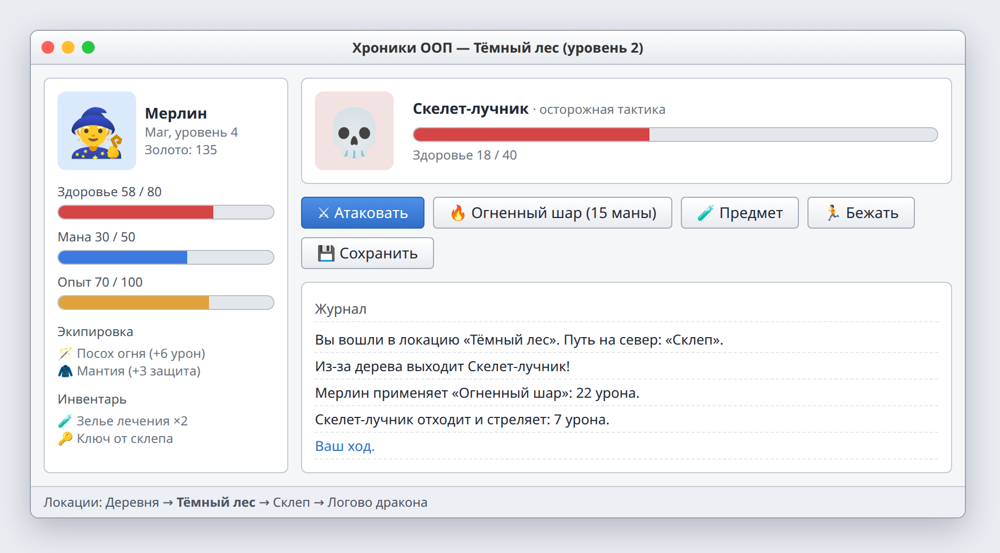

# Итоговый проект. РПГ

| | |
| --- | --- |
| Состав | 4 человека (при необходимости 3) |
| Выдача | 12.12.2026 |
| Срок PR | 22.01.2027, 23:59 |
| Защита | 23.01.2027 |
| Репозиторий | `oop-rpg-название`, один на команду |
| Баллы | 28: работает 10, понимает 8, спроектировано 6, выступает 4 |
| Допуск | приняты не меньше 3 лаб из 4 |



*Примерный вид. Достаточно кнопок, текста и полосок здоровья, графика по желанию.*

## Темы

Проектирование классов, диаграмма классов, наследование и композиция, паттерны Стратегия, Фабрика, Наблюдатель, работа в команде через ветки и Pull Request.

## Теория

**Работа в команде.** Каждая задача делается в своей ветке и попадает в `main` через Pull Request, который смотрит другой участник. Сначала команда рисует общую диаграмму и договаривается, через какие методы части общаются (`TakeDamage`, `Use(hero)`), потом каждый пишет свою часть.

**Стратегия.** Поведение выносится в отдельный объект и может подменяться. Враг спрашивает свою стратегию, что делать в бою. Новое поведение = новый класс, бой не меняется.

```csharp
public interface IBehavior
{
    string Act(Enemy self, Hero hero);
}

public class Aggressive : IBehavior
{
    public string Act(Enemy self, Hero hero)
    {
        hero.TakeDamage(self.Strength);
        return $"{self.Name} атакует: -{self.Strength}";
    }
}

public class Enemy : Character
{
    public IBehavior Behavior { get; set; }
    public string TakeTurn(Hero hero) => Behavior.Act(this, hero);
}
```

**Фабрика.** Создание объектов собрано в одном месте. Локация просит у фабрики врагов для уровня и не знает их классов.

```csharp
public static class EnemyFactory
{
    public static List<Enemy> Create(int level) { /* ... */ }
}
```

**Наблюдатель.** Объект сообщает о событии подписчикам, не зная, кто они. Герой вызывает событие «получен уровень», окно и журнал обновляются сами.

```csharp
public class Hero : Character
{
    public event Action<int>? LevelUp;

    public void GainExp(int amount)
    {
        // ...
        LevelUp?.Invoke(Level);
    }
}
```

## Задание

Пошаговая ролевая игра в окне. Игрок выбирает класс героя, ходит между локациями, сражается с врагами, собирает и надевает предметы, растёт в уровне и побеждает финального противника. Минимальный интерфейс: кнопки действий, характеристики героя, журнал событий.

Пример распределения ролей:

| Участник | Часть |
| --- | --- |
| 1 | Персонажи: базовый класс, классы героя, враги, опыт и уровни |
| 2 | Бой: ходы, урон, способности, поведение врагов |
| 3 | Предметы: иерархия предметов, инвентарь, экипировка, торговец |
| 4 | Мир и окно: локации, перемещение, сохранение, главное окно |

## Чек-лист (критерий «Работает»)

1. **Команда.** У каждого свои коммиты, работа через ветки и Pull Request. README: идея, запуск, управление, диаграмма классов, кто что делал.
2. **Герой.** Выбор из 3 и более классов героя с разными характеристиками и способностями.
3. **Персонажи.** Общий базовый класс героев и врагов. Не меньше 3 видов врагов с разным поведением, сделанным через переопределение или стратегию.
4. **Бой.** Атака, способность с ценой (мана или перезарядка), предмет, побег. Урон зависит от характеристик и экипировки. Победа и гибель.
5. **Предметы.** Базовый класс предмета и не меньше 3 видов. Надеть, снять, использовать; экипировка меняет характеристики.
6. **Мир.** Не меньше 3 связанных локаций с врагами и находками.
7. **Развитие.** Опыт, уровни с ростом характеристик, золото и награды.
8. **Сохранение.** Сохранение и загрузка героя, уровня, инвентаря и положения.
9. **Цель.** Финальный противник, экраны победы и поражения.
10. **Устойчивость.** Недопустимые действия (купить без денег, надеть зелье) не роняют программу.

## Защита

12–15 минут на команду, присутствуют все.

1. Демо: выбор героя, бой, предмет, новый уровень, сохранение и загрузка, финальный бой.
2. Каждый по диаграмме рассказывает свою часть (до 2 минут).
3. Каждому два вопроса: по своему коду и общий.

Каждый критерий: да (все баллы), частично (половина), нет (0).

| Критерий | Баллы | Кому | Да | Частично |
| --- | --- | --- | --- | --- |
| Работает | 10 | команде | работают 8–10 пунктов чек-листа | 4–7 пунктов |
| Понимает | 8 | каждому | рассказал свою часть, ответил на вопрос по своему коду и на общий вопрос | 1–2 из трёх |
| Спроектировано | 6 | команде | диаграмма совпадает с кодом, поведение без проверки типа, паттерн по делу | 1–2 из трёх |
| Выступает | 4 | каждому | рассказал сам, уложился в 2 минуты, есть свои коммиты | 1–2 из трёх |

Не пришёл на защиту: 0.
