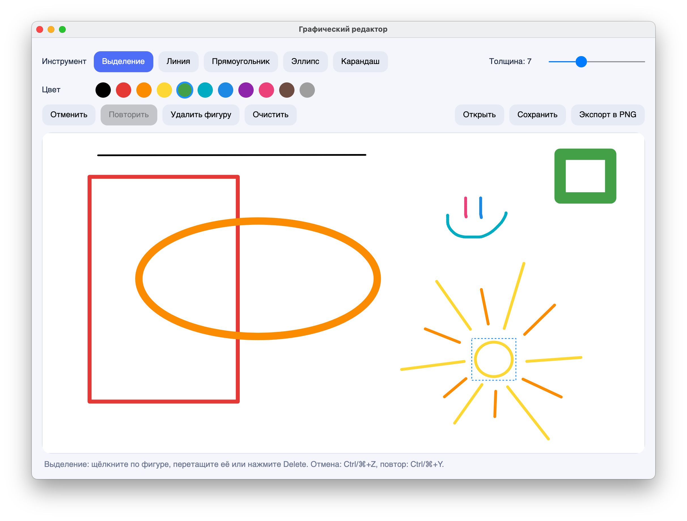

# Лаба 2. Графический редактор

**Автор:** Лихач Алевтина, Б9125-01.03.02ии(4)

## Как запустить

Нужен .NET SDK (проект на C#, библиотека окна Avalonia, работает на macOS, Windows и Linux).

```
cd lab2-paint
dotnet run
```

## Как пользоваться

- **Инструмент:** выберите кнопку «Линия», «Прямоугольник», «Эллипс» или «Карандаш». Выбранный инструмент залит синим.
- **Цвет и толщина:** кружки с цветами и ползунок толщины над холстом.
- **Рисование:** нажмите на холсте и протяните мышью, фигура видна во время протягивания. Прямоугольник и эллипс можно тянуть в любую сторону.
- **Отменить / Повторить:** кнопки или Ctrl+Z / Ctrl+Y (на Mac Cmd+Z / Cmd+Y). Отменяются рисование, удаление, очистка и перемещение.
- **Очистить:** убирает все фигуры (это тоже можно отменить).
- **Выделение (★):** инструмент «Выделение», щёлкнуть по фигуре, перетащить её мышью, удалить клавишей Delete или кнопкой «Удалить фигуру».
- **Открыть / Сохранить:** рисунок сохраняется в JSON-файл и открывается обратно со всеми фигурами, цветами и толщиной.
- **Экспорт в PNG (★★):** сохраняет картинку с холста.

## Скриншот



## Чек-лист

- [x] 1. Окно: холст, выбор инструмента, цвета и толщины, выбранный инструмент виден
- [x] 2. Фигуры: линия, прямоугольник, эллипс с предпросмотром в любом направлении, карандаш рисует кривую
- [x] 3. Иерархия: абстрактный `Shape`, у каждой фигуры свой `Draw`, рисунок рисуется одним циклом без проверки типа
- [x] 4. Отмена и очистка: методы `Drawing` (`RemoveLast`, `Clear`) и их использование через историю команд (Ctrl+Z, «Очистить»)
- [x] 5. Файл: сохранение в JSON и открытие, объект нужного класса создаёт фабрика `ShapeFactory`
- [x] 6. README
- [x] ★ Выделение щелчком (`Shape.Contains`), перемещение мышью, удаление клавишей Delete
- [x] ★★ Отмена и повтор (Ctrl+Z, Ctrl+Y) через паттерн Команда, экспорт в PNG

## Как устроен проект

Наследование: `LineShape`, `RectShape`, `EllipseShape`, `PencilShape` наследуются от абстрактного `Shape`. `MainWindow` наследуется от `Window`, `DrawingCanvas` от `Control`, `App` от `Application` (библиотека Avalonia).

| Файл | Класс | Что делает |
|------|-------|------------|
| `Shape.cs` | `Shape` (абстрактный) | Общее для фигур: две точки, цвет, толщина, `MoveEnd`, `Move`, рамка. Абстрактные `Draw` и `Contains` |
| `LineShape.cs` | `LineShape` | Линия: свой `Draw` и `Contains` |
| `RectShape.cs` | `RectShape` | Прямоугольник: свой `Draw` и `Contains` |
| `EllipseShape.cs` | `EllipseShape` | Эллипс: свой `Draw` и `Contains` |
| `PencilShape.cs` | `PencilShape` | Карандаш: список точек, переопределяет `MoveEnd`, рисует ломаную |
| `ShapeFactory.cs` | `ShapeFactory` | Фабрика: словарь «имя типа → как создать». Кнопки инструментов, мышь и загрузка файла используют её |
| `Drawing.cs`, `ShapeData.cs` | `Drawing`, `ShapeData` | Рисунок: список фигур (композиция), добавить, убрать, очистить, найти под курсором, нарисовать, сохранить, загрузить |
| `Commands.cs`, `History.cs` | `ICommand`, `AddShapeCommand`, `RemoveShapeCommand`, `ClearCommand`, `MoveShapeCommand`, `History` | Паттерн Команда: каждое действие — объект с `Execute` и `Undo`, история хранит два стека |
| `DrawingCanvas.cs` | `DrawingCanvas` | Холст: каждый раз перерисовывается по списку фигур, показывает предпросмотр и рамку выделения |
| `MainWindow.axaml`, `MainWindow.axaml.cs` | `MainWindow` | Окно: инструменты, цвет, толщина, мышь, клавиши, файлы |
| `Program.cs`, `App.axaml`, `App.axaml.cs` | `Program`, `App` | Запуск приложения |

**Паттерны.** *Фабрика* собирает создание фигур по имени в одном месте: новая фигура — это новый класс и одна строка в словаре. *Команда* делает каждое действие объектом, поэтому его можно отменить и повторить.

**Как добавить треугольник.** Написать класс `TriangleShape : Shape` с `Title`, `Draw` и `Contains` и добавить одну строку в `ShapeFactory.Kinds`. Окно, загрузка и цикл рисования не меняются.

Использовано: Avalonia, `System.Text.Json`, LINQ.
