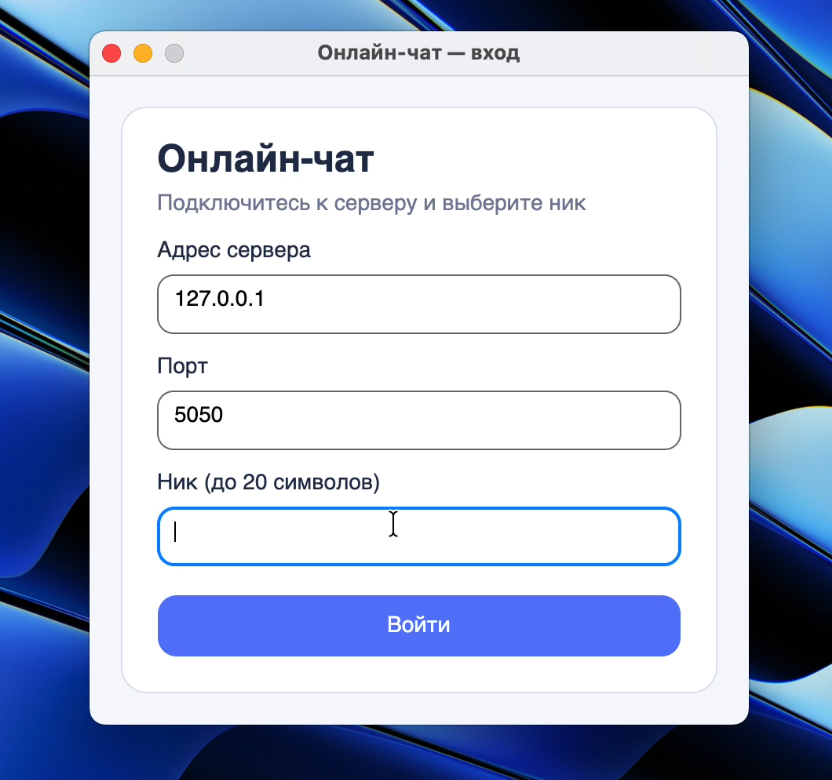
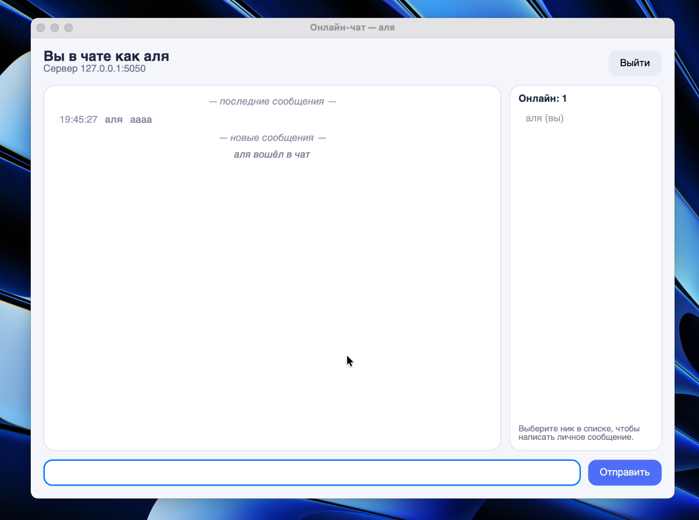

# Лаба 3. Онлайн-чат

**Авторы (пара):**
- Лихач Алевтина, Б9125-01.03.02ии(4)
- Ольховикова Алёна, Б9125-01.03.02ии(4)

## Как запустить

Нужен .NET SDK (проект на C#, окно клиента — Avalonia, работает на macOS, Windows и Linux).
Программы две: сервер (консольный) и клиент (окно). Запускать из папки `lab3-chat`.

**1. Сервер** (в первом терминале):

```
cd lab3-chat
dotnet run --project Chat.Server -- 5050
```

Число после `--` — порт (если не указать, будет 5050). Сервер напечатает адреса, по которым можно подключиться. Остановить: Ctrl+C.

**2. Клиент** (в другом терминале; можно запустить несколько клиентов подряд, каждый в своём терминале):

```
cd lab3-chat
dotnet run --project Chat.Client
```

В окне входа: адрес `127.0.0.1` (сервер на этом же компьютере), порт `5000`, любой ник.
Если сервер запущен на другом компьютере в той же сети, вместо `127.0.0.1` вводится его адрес из строки «Адрес для подключения с другого компьютера» в окне сервера. На компьютере с сервером система может спросить разрешение для входящих подключений — нужно разрешить.

## Скриншот




## Чек-лист

- [x] 1. Сервер и клиент — две отдельные программы; вход по адресу, порту и нику; занятый ник отклоняется с понятным сообщением
- [x] 2. Лента: ник, время, текст; уведомления «вошёл» и «вышел»; список «онлайн» обновляется у всех
- [x] 3. Отправка кнопкой и клавишей Enter; сообщение получают все подключённые
- [x] 4. Надёжность: сервер выключен — в окне входа понятная ошибка, без падения; окно не зависает (сеть в фоновых потоках); отключение клиента не ломает сервер
- [x] 5. Классы: `ChatMessage`, `ChatServer`, `ClientHandler`, `ChatClient` (событие `MessageReceived`), `LoginWindow`, `ChatWindow`; общий список клиентов под `lock`; обновление окна из сетевого потока через `Dispatcher.UIThread`
- [x] 6. README
- [x] ★ Личные сообщения: выбрать ник в списке «Онлайн», сообщение видят только двое, в ленте оно выделено цветом и подписью «(лично)»
- [x] ★★ История: сервер дописывает сообщения в файл `history.jsonl` и отправляет новому клиенту последние 20, в том числе после перезапуска сервера

## Как устроен проект

Решение состоит из трёх проектов: общая библиотека, сервер и клиент.

| Файл | Класс | Что делает |
|------|-------|------------|
| `Chat.Common/ChatMessage.cs` | `ChatMessage` | Одно сообщение протокола. `ToJson()` превращает объект в строку, `FromJson()` — строку в объект |
| `Chat.Common/Protocol.cs` | `MessageTypes`, `ChatDefaults` | Виды сообщений и общие настройки (порт по умолчанию, длина ника, размер истории) |
| `Chat.Server/Program.cs` | `Program` | Запуск сервера, порт из аргумента, подсказка с адресами, остановка по Ctrl+C |
| `Chat.Server/ChatServer.cs` | `ChatServer` | Принимает подключения (один поток на клиента), хранит клиентов, проверяет ник, рассылает сообщения, личные сообщения |
| `Chat.Server/ClientHandler.cs` | `ClientHandler` | Один подключённый клиент: читает его строки, разбирает, отправляет ему сообщения |
| `Chat.Server/MessageHistory.cs` | `MessageHistory` | История в файле (★★) |
| `Chat.Client/ChatClient.cs` | `ChatClient` | Сеть клиента без знания об окнах: подключение, фоновые потоки чтения и отправки, события `MessageReceived` и `Disconnected` |
| `Chat.Client/LoginWindow.axaml(.cs)` | `LoginWindow` | Окно входа |
| `Chat.Client/ChatWindow.axaml(.cs)` | `ChatWindow` | Окно чата: лента, список «Онлайн», поле ввода |
| `Chat.Client/App.axaml(.cs)`, `Program.cs` | `App`, `Program` | Запуск приложения Avalonia |

**Паттерн Наблюдатель (Observer).** `ChatClient` объявляет событие `MessageReceived`, а `ChatWindow` на него подписывается. Клиент не знает, кто и что сделает с сообщением, поэтому его можно использовать и без окна.

**Потоки и безопасность.** Сервер: один поток на клиента, общий список клиентов защищён `lock`, отправка по сети идёт вне `lock`. Клиент: чтение и отправка в фоновых потоках, обновление окна через `Dispatcher.UIThread.Post`.

## Протокол

Транспорт: TCP. Каждое сообщение — **одна строка JSON**, заканчивается символом `\n`. Читают построчно, поэтому границы сообщений не теряются.

Поля сообщения: `type`, `nick`, `text`, `time` (UTC), `to` (получатель, только для личных), `users` (только для списка онлайн).

| Тип (`type`) | Кто отправляет | Что значит |
|--------------|----------------|------------|
| `join` | клиент | Первое сообщение: войти под ником `nick` |
| `ok` | сервер | Вход принят |
| `error` | сервер | Ошибка, причина в `text` (ник занят, получатель не в сети и т.д.) |
| `text` | клиент → сервер → все | Сообщение всем |
| `private` | клиент → сервер → двое | Личное сообщение, получатель в `to` |
| `system` | сервер | «Ник вошёл в чат» / «Ник вышел из чата» |
| `users` | сервер | Список ников онлайн в `users` |
| `history` | сервер | Сообщение из истории (приходит новому клиенту сразу после `ok`) |

Пример: `{"type":"text","nick":"Аля","text":"Привет","time":"2026-11-15T12:00:00Z","to":null,"users":null}`

Личные сообщения в историю не пишутся: их видят только двое.

## Кто что делал

| Участник | Что сделал |
|----------|------------|
| Лихач Алевтина | Клиент: сетевой класс `ChatClient` (подключение, фоновые потоки чтения и отправки, события `MessageReceived` и `Disconnected`), окно входа `LoginWindow`, окно чата `ChatWindow` (лента, список «Онлайн», отправка кнопкой и Enter, личные сообщения ★), обработка ошибок при недоступном сервере, README и скриншот|
| Ольховикова Алёна | Сервер: `ChatServer` (приём подключений, проверка ника, рассылка, `lock` на списке клиентов), `ClientHandler` (поток на клиента, разбор сообщений, личные сообщения ★), `MessageHistory` (история в файле, последние 20 сообщений ★★), общая часть `ChatMessage` и протокол в `Chat.Common` |

Протокол (формат сообщений и их типы) согласовывали вместе, затем каждый писал свою часть и проверял её вдвоём: сервер и два окна клиента на одном компьютере.

Использовано: Avalonia, `System.Net.Sockets`, `System.Text.Json`, потоки (`Thread`), `lock`.
